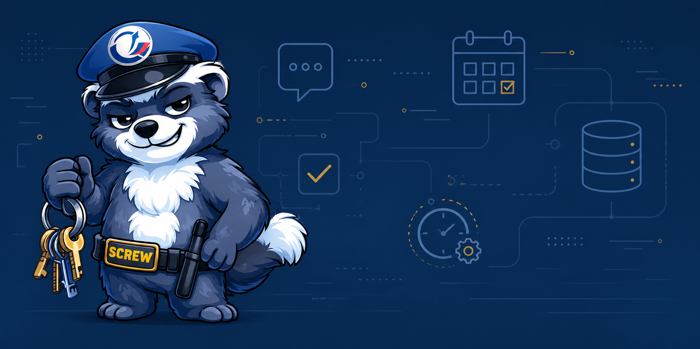
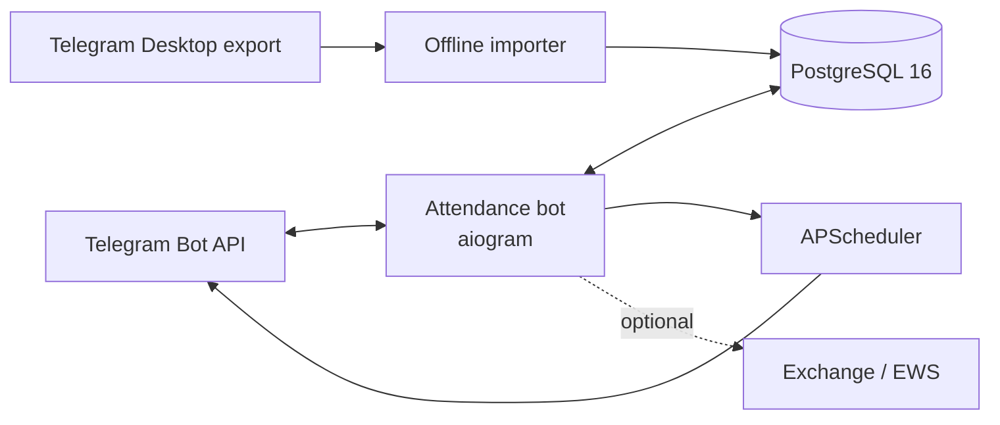

<p align="center">
  
</p>

<h1 align="center">SCREW Attendance Bot</h1>

<p align="center">
  A privacy-conscious Telegram bot for office attendance, absences, and operational reporting.
</p>

<p align="center">
  <a href="README.md">Русский</a> ·
  <a href="README.en.md"><strong>English</strong></a>
</p>

<p align="center">
  <a href="https://github.com/leputain/scew/actions/workflows/ci.yml"></a>
  
  
  
  
  <a href="LICENSE"></a>
  
</p>

<p align="center">
  <a href="#features">Features</a> ·
  <a href="#architecture">Architecture</a> ·
  <a href="#quick-start">Quick start</a> ·
  <a href="#security">Security</a> ·
  <a href="#documentation">Documentation</a>
</p>

## About

SCREW automates recurring Telegram attendance polls, tracks employee
availability, and produces reproducible historical reports. The runtime uses
`aiogram`, PostgreSQL stores the data, and APScheduler runs periodic jobs.

| Accurate history | Secure operations | Controlled rollout |
|---|---|---|
| Expected-participant snapshots and poll-date availability | Fail-closed authorization, opt-in notifications, no secrets in source | Idempotent migrations, health diagnostics, backups, and smoke checks |

> [!IMPORTANT]
> Every feature capable of posting to a work chat is disabled in `.env.example`.
> Configure and verify destination chat/topic IDs first, then enable modules one
> at a time.

## Features

- one-time invitation registration with approval;
- `user`, `manager`, and `admin` roles with fail-closed access control;
- scheduled Telegram polls, reminders, and automatic closing;
- vacation, sick leave, personal leave, and day-off accounting;
- expected-participant snapshots for accurate historical statistics;
- birthday, policy-notification, and monthly reporting workflows;
- opt-in chat activity statistics without storing full message text;
- Telegram and EWS reports, scheduler diagnostics, and aggregated errors;
- Docker Compose, pinned dependencies, and GitHub Actions CI.

## Architecture



Telegram-specific runtime code lives in `apps/attendance_bot`. Domain models,
repositories, and services live in `core/screw_core`. Initial database SQL is in
`infra/postgres/init`; incremental idempotent migrations are in
`infra/postgres/migrations`.

## Quick start

Requirements: Docker Engine 24+ and Docker Compose 2+.

```bash
cp .env.example .env
# Set POSTGRES_PASSWORD, ATTENDANCE_BOT_TOKEN, and the required Telegram IDs.
docker compose config --quiet
docker compose up -d --build
docker compose ps
```

PostgreSQL is published on the loopback interface only. Run the smoke check
after startup:

```bash
bash scripts/post_deploy_smoke.sh
docker compose logs --tail=100 attendance_bot
```

See [`docs/deployment.md`](docs/deployment.md) for migrations, backups, rollout,
and rollback procedures. The operational documentation is currently maintained
in Russian; commands and configuration names are language-independent.

## Security

- `.env`, dumps, logs, certificates, private media, and wheelhouse files are excluded from Git;
- unknown, terminated, and revoked users are blocked before handlers run;
- secrets are injected through the environment and must not appear in logs;
- chat statistics are disabled by default and do not store full message text;
- history is imported offline from a Telegram Desktop export;
- CI audits tracked files for high-risk secrets and private data.

Do not disclose vulnerabilities in a public issue. Follow [`SECURITY.md`](SECURITY.md).
The data-handling model is documented in [`docs/privacy.md`](docs/privacy.md).

## Development

```bash
python -m pip install -r requirements.lock.txt -r requirements-dev.txt
python -m compileall -q apps core tests scripts
ruff check apps core tests scripts
python -m pytest -q tests
python scripts/public_repo_audit.py
```

The lock file targets Python 3.12. Build an offline wheelhouse locally; it is not
committed to the repository:

```bash
bash scripts/build_wheelhouse.sh
PIP_NO_INDEX=1 docker compose build attendance_bot
```

See [`CONTRIBUTING.md`](CONTRIBUTING.md) for the contribution and pull request
workflow.

## Repository layout

```text
apps/attendance_bot/       Telegram runtime, routers, jobs, and UI
core/screw_core/           domain services, repositories, and models
infra/postgres/            initial schema and idempotent migrations
scripts/                   deployment, backup, restore, import, and audits
tests/                     unit and regression tests
```

## Documentation

| Document | Purpose |
|---|---|
| [Architecture](docs/architecture.md) | components, data flows, and trust boundaries |
| [Configuration](docs/configuration.md) | environment variables and secure defaults |
| [Deployment](docs/deployment.md) | startup, migrations, backup, rollout, and rollback |
| [Operations](docs/operations.md) | health, diagnostics, and routine checks |
| [Privacy](docs/privacy.md) | personal data and chat statistics |
| [Release checklist](docs/release-checklist.md) | production release controls |
| [Telegram polls](docs/telegram-polls.md) | rich poll media and option configuration |
| [Brand assets](docs/assets/README.md) | artwork provenance and usage |

The current application version is stored in [`VERSION`](VERSION). Production
secrets, real Telegram IDs, exports, and backups are not part of the repository.

## Author and license

Created by [leputain](https://github.com/leputain).

The source code and documentation are licensed under the
[Apache License 2.0](LICENSE). Redistributions of the original or modified work
must retain the [`NOTICE`](NOTICE) file containing the author attribution.

The avatar and cover under `docs/assets/*.png` are not covered by the software
license. Their usage terms are documented separately in
[`docs/assets/README.md`](docs/assets/README.md).
