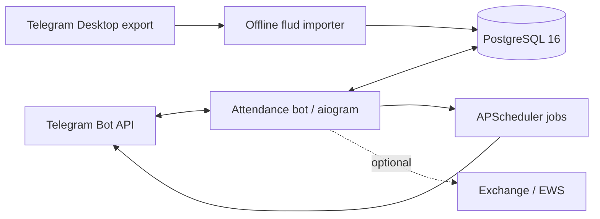

# SCREW Attendance Bot

[](https://github.com/leputain/scew/actions/workflows/ci.yml)


Telegram-бот для учёта офисной явки, управления отсутствиями и подготовки
операционных отчётов. Runtime построен на `aiogram`, данные хранятся в
PostgreSQL, периодические задачи выполняет APScheduler.

## Возможности

- регистрация сотрудников по одноразовым приглашениям с подтверждением;
- роли `user`, `manager`, `admin` и fail-closed проверка доступа;
- ежедневные Telegram Poll с напоминаниями и автоматическим закрытием;
- отпуск, больничный, отгул и выходной с учётом даты опроса;
- снимок ожидаемых участников для точной исторической статистики;
- уведомления о нарушениях, поздравления с днями рождения и месячные отчёты;
- opt-in статистика активности чата без хранения полного текста сообщений;
- Telegram и EWS-отчёты, health diagnostics, backup/restore и smoke-check;
- Docker Compose, pinned Python dependencies и GitHub Actions CI.

## Архитектура



Код разделён на Telegram runtime в `apps/attendance_bot` и независимые модели,
репозитории и сервисы в `core/screw_core`. SQL для новой базы находится в
`infra/postgres/init`, пошаговые изменения существующей базы в
`infra/postgres/migrations`.

## Быстрый старт

Требования: Docker Engine 24+ и Docker Compose 2+.

```bash
cp .env.example .env
# Заполните POSTGRES_PASSWORD, ATTENDANCE_BOT_TOKEN и Telegram chat/user IDs.
docker compose config --quiet
docker compose up -d --build
docker compose ps
```

`docker-compose.yml` публикует PostgreSQL только на loopback-интерфейсе. Все
уведомления и сбор статистики, способные писать в рабочие чаты, выключены в
`.env.example` и включаются явно.

Проверка после запуска:

```bash
bash scripts/post_deploy_smoke.sh
docker compose logs --tail=100 attendance_bot
```

## Разработка

```bash
python -m pip install -r requirements.lock.txt -r requirements-dev.txt
python -m compileall -q apps core tests scripts
ruff check apps core tests scripts
python -m pytest -q tests
python scripts/public_repo_audit.py
```

Полный lock-файл рассчитан на Python 3.12. Для изолированной сборки wheelhouse
создаётся локально и не коммитится:

```bash
bash scripts/build_wheelhouse.sh
PIP_NO_INDEX=1 docker compose build attendance_bot
```

## Безопасность и приватность

- `.env`, дампы, логи, сертификаты, приватные media и wheel-файлы исключены из Git;
- неизвестные и отозванные пользователи блокируются до выполнения handler;
- секреты передаются только через окружение и не должны попадать в логи;
- модуль статистики чата по умолчанию выключен и не хранит полный текст;
- импорт истории выполняется только из локального Telegram Desktop export;
- перед каждым push CI проверяет tracked-файлы на высокорисковые секреты.

Подробности: [модель приватности](docs/privacy.md) и
[политика раскрытия уязвимостей](SECURITY.md).

## Документация

| Документ | Назначение |
|---|---|
| [Architecture](docs/architecture.md) | компоненты, потоки данных и границы доверия |
| [Configuration](docs/configuration.md) | переменные окружения и безопасные defaults |
| [Deployment](docs/deployment.md) | запуск, миграции, backup, rollout и rollback |
| [Operations](docs/operations.md) | health, диагностика и типовые проверки |
| [Privacy](docs/privacy.md) | персональные данные и статистика чатов |
| [Release checklist](docs/release-checklist.md) | контроль перед production-релизом |
| [Public release](docs/public-release-checklist.md) | контроль перед открытием доступа к репозиторию |
| [Telegram polls](docs/telegram-polls.md) | rich poll media и конфигурация вариантов |

## Структура

```text
apps/attendance_bot/       Telegram runtime, routers, jobs and UI
core/screw_core/           domain services, repositories and models
infra/postgres/            initial schema and idempotent migrations
scripts/                   deploy, backup, restore, import and audits
tests/                     unit and regression tests
```

Текущая версия приложения хранится в [`VERSION`](VERSION). Production-секреты,
реальные Telegram ID и резервные копии не являются частью репозитория.
