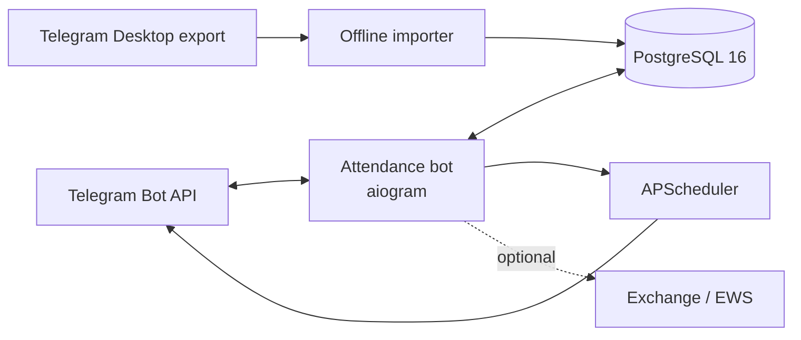

<p align="center">
  
</p>

<h1 align="center">SCREW Attendance Bot</h1>

<p align="center">
  Telegram-бот для учёта офисной явки, отсутствий и операционной отчётности.
</p>

<p align="center">
  <a href="README.md"><strong>Русский</strong></a> ·
  <a href="README.en.md">English</a>
</p>

<p align="center">
  <a href="https://github.com/leputain/scew/actions/workflows/ci.yml"></a>
  
  
  
  
  <a href="LICENSE"></a>
  
</p>

<p align="center">
  <a href="#возможности">Возможности</a> ·
  <a href="#архитектура">Архитектура</a> ·
  <a href="#быстрый-старт">Быстрый старт</a> ·
  <a href="#безопасность">Безопасность</a> ·
  <a href="#документация">Документация</a>
</p>

## О проекте

SCREW автоматизирует ежедневные Telegram-опросы, учитывает доступность
сотрудников и формирует воспроизводимую статистику. Runtime построен на
`aiogram`, данные хранятся в PostgreSQL, а периодические задачи выполняет
APScheduler.

| Точный учёт | Безопасная эксплуатация | Управляемый rollout |
|---|---|---|
| Исторические снимки ожидаемых участников и статусы на дату опроса | Fail-closed доступ, opt-in уведомления и отсутствие секретов в source | Идемпотентные миграции, health diagnostics, backup и smoke-check |

> [!IMPORTANT]
> Все функции, способные публиковать сообщения в рабочие чаты, выключены в
> `.env.example`. Сначала настройте окружение и проверьте целевые chat/topic ID,
> затем включайте нужные модули по одному.

## Возможности

- регистрация по одноразовым приглашениям с подтверждением;
- роли `user`, `manager`, `admin` и единая fail-closed проверка доступа;
- ежедневные Telegram Poll, напоминания и автоматическое закрытие;
- отпуск, больничный, отгул и выходной с учётом даты опроса;
- снимки ожидаемых участников для точной исторической статистики;
- поздравления, уведомления о нарушениях и месячные отчёты;
- opt-in статистика активности чата без хранения полного текста сообщений;
- Telegram- и EWS-отчёты, диагностика scheduler jobs и агрегированные ошибки;
- Docker Compose, фиксированные зависимости и GitHub Actions CI.

## Архитектура



Код разделён на Telegram runtime в `apps/attendance_bot` и независимые модели,
репозитории и сервисы в `core/screw_core`. SQL для новой базы находится в
`infra/postgres/init`, пошаговые изменения существующей базы — в
`infra/postgres/migrations`.

## Быстрый старт

Требования: Docker Engine 24+ и Docker Compose 2+.

```bash
cp .env.example .env
# Заполните POSTGRES_PASSWORD, ATTENDANCE_BOT_TOKEN и необходимые Telegram ID.
docker compose config --quiet
docker compose up -d --build
docker compose ps
```

PostgreSQL публикуется только на loopback-интерфейсе. После запуска выполните:

```bash
bash scripts/post_deploy_smoke.sh
docker compose logs --tail=100 attendance_bot
```

Подробный порядок миграции, резервного копирования и отката описан в
[руководстве по развёртыванию](docs/deployment.md).

## Безопасность

- `.env`, дампы, логи, сертификаты, приватные media и wheelhouse исключены из Git;
- неизвестные, исключённые и отозванные пользователи блокируются до handler;
- секреты передаются через окружение и не должны попадать в логи;
- статистика чатов по умолчанию выключена и не хранит полный текст;
- импорт истории выполняется offline из Telegram Desktop export;
- CI проверяет tracked-файлы на высокорисковые секреты и приватные данные.

Не публикуйте найденную уязвимость в issue. Используйте порядок из
[`SECURITY.md`](SECURITY.md). Модель обработки данных описана в
[`docs/privacy.md`](docs/privacy.md).

## Разработка

```bash
python -m pip install -r requirements.lock.txt -r requirements-dev.txt
python -m compileall -q apps core tests scripts
ruff check apps core tests scripts
python -m pytest -q tests
python scripts/public_repo_audit.py
```

Lock-файл рассчитан на Python 3.12. Изолированный wheelhouse создаётся локально
и не коммитится:

```bash
bash scripts/build_wheelhouse.sh
PIP_NO_INDEX=1 docker compose build attendance_bot
```

Правила изменений, тестирования и pull request описаны в
[`CONTRIBUTING.md`](CONTRIBUTING.md).

## Структура

```text
apps/attendance_bot/       Telegram runtime, routers, jobs and UI
core/screw_core/           domain services, repositories and models
infra/postgres/            initial schema and idempotent migrations
scripts/                   deploy, backup, restore, import and audits
tests/                     unit and regression tests
```

## Документация

| Документ | Назначение |
|---|---|
| [Architecture](docs/architecture.md) | компоненты, потоки данных и границы доверия |
| [Configuration](docs/configuration.md) | переменные окружения и безопасные defaults |
| [Deployment](docs/deployment.md) | запуск, миграции, backup, rollout и rollback |
| [Operations](docs/operations.md) | health, диагностика и типовые проверки |
| [Privacy](docs/privacy.md) | персональные данные и статистика чатов |
| [Release checklist](docs/release-checklist.md) | контроль перед production-релизом |
| [Telegram polls](docs/telegram-polls.md) | rich poll media и конфигурация вариантов |
| [Brand assets](docs/assets/README.md) | происхождение и правила использования графики |

Текущая версия хранится в [`VERSION`](VERSION). Production-секреты, реальные
Telegram ID, выгрузки и резервные копии не являются частью репозитория.

## Автор и лицензия

Автор проекта — [leputain](https://github.com/leputain).

Исходный код и документация распространяются по лицензии
[Apache License 2.0](LICENSE). При распространении исходной или изменённой
версии необходимо сохранять файл [`NOTICE`](NOTICE) с указанием автора.

Аватар и обложка в `docs/assets/*.png` не входят в лицензию на код. Условия их
использования описаны отдельно в [`docs/assets/README.md`](docs/assets/README.md).
