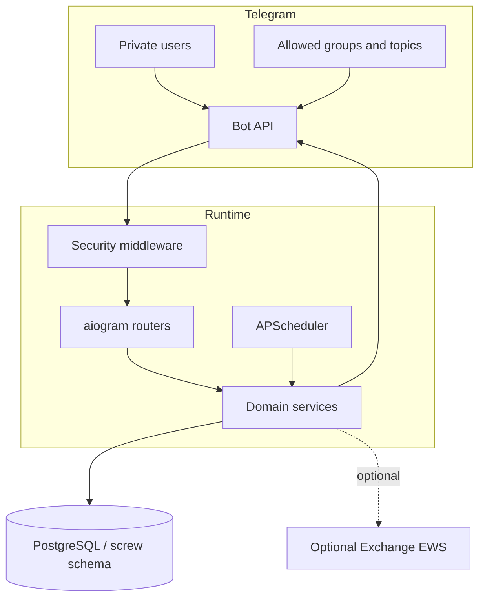

# Architecture

## Контекст

SCREW — один Telegram-бот и одна PostgreSQL database. Это намеренный modular
monolith: транзакции опросов, статусов и уведомлений остаются в одной схеме, а
Telegram-specific код отделён от domain services.

## Границы модулей

| Модуль | Ответственность |
|---|---|
| `apps/attendance_bot` | Telegram updates, keyboards, jobs, lifecycle |
| `core/screw_core/repos` | параметризованный SQL и транзакционные операции |
| `core/screw_core/services` | бизнес-правила без привязки к router |
| `infra/postgres` | начальная схема и миграции |
| `scripts` | эксплуатация и offline import |

Router не должен собирать SQL строками или обходить access middleware. Repo не
должен отправлять Telegram-сообщения. Периодические задачи вызывают те же
services/repositories, что и ручные admin actions.

## Модель данных

Основные сущности:

- `users`, `org_departments`, `registration_invites`;
- `poll_runs`, `poll_expected_users`, `attendance_marks`;
- `user_day_statuses`, `events`, `feature_flags`;
- `flud_messages`, агрегаты реакций и история digest runs;
- `poll_config`, `poll_skip_dates`.

`poll_expected_users` фиксирует ожидаемый состав на момент опроса. Для старых
опросов без snapshot применяется исторический fallback, а отчёт помечается как
приблизительный.

## Надёжность

- liveness heartbeat проверяет процесс и event loop, но не внешний Telegram API;
- Telegram API диагностируется отдельной задачей без завершения процесса;
- автоматические публикации используют event dedup keys;
- ошибка отправки не создаёт successful dedup event;
- rollout сохраняет предыдущий Docker image как rollback anchor.

## Trust boundaries

Внешними и недоверенными считаются Telegram updates, import-файлы и значения
пользовательского ввода. ФИО и preview экранируются перед HTML-выводом. Доступ
проверяется fail-closed: неизвестный, отозванный пользователь или ошибка БД не
должны достигать handler.
